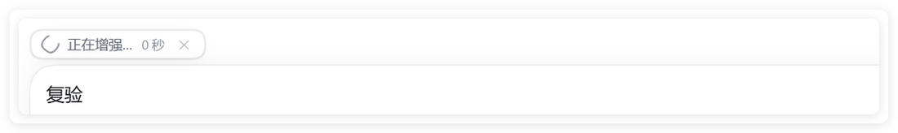
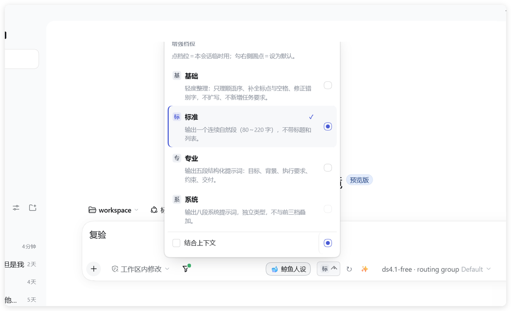
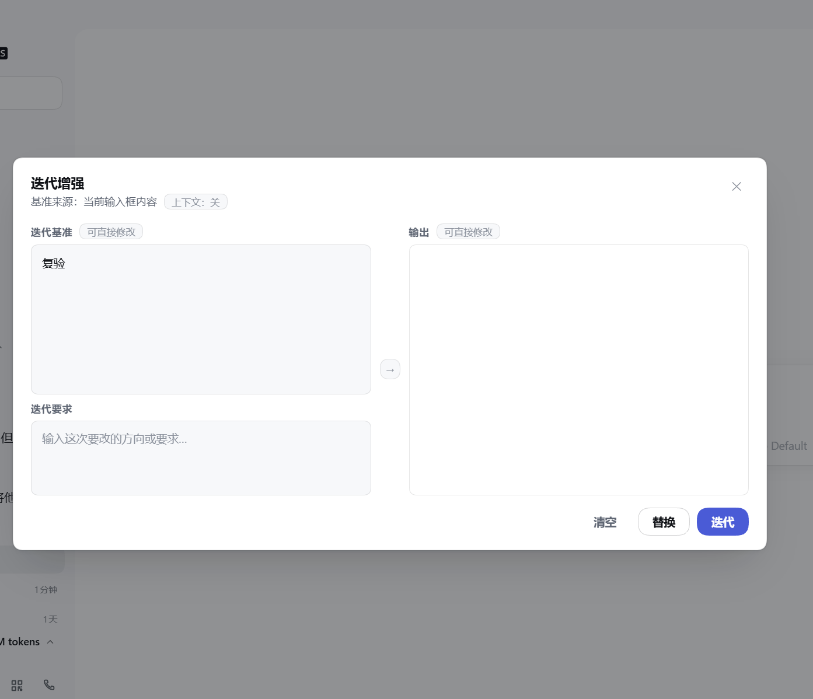

# Prompt Enhancer

[](LICENSE)
[](https://www.npmjs.com/package/dsh-prompt-enhance-cn)
[](#热键程序与-skill)
[](#热键程序与-skill)

把随手写的草稿，改写成结构清楚、约束完整、可以直接发给模型的提示词——不改原意、不编造需求。改多深由档位决定：**基础**只理顺语序，**标准**出一段连续提示词，**专业**出五段结构化任务书，**系统**出八段式系统提示词。一轮不满意还能接着迭代。四档的措辞来自同一份规则文件，插件与桌面热键共用，不会分叉。

它分成两个独立部分，按需安装，也可以都装：

| 部分 | 用在哪 | 怎么用 |
| --- | --- | --- |
| **DSH 插件** | DeepSeek Harness Web GUI | 输入框旁的 ✨ 按钮一键增强、档位胶囊、全局快捷键 |
| **热键程序 + Skill** | Codex、ChatGPT、Claude Code 等桌面 agent | 全局热键一键替换草稿；`$p` / `$prompt-enhancer` 在对话里直接调用 |

下面的示例图都来自 **DSH 插件**；热键程序与 Skill 的界面不在这里，下一节单独说。

日常用法就是按一下：输入框上方浮出「正在增强」的计时胶囊，草稿原样留着。



一两秒后增强结果直接替换草稿，上方给出「已用增强结果替换原提示词」与「撤销 Ctrl+Z」，不满意一键回退。


改多深由档位决定，输入框下拉里四档并列，当前档位有勾选与圆点，下方是「结合上下文」开关。



想要接着打磨时再走进阶的迭代工作台：左栏「迭代基准」预填输入框内容、可直接改，下方填一句迭代要求（留空就是普通增强），右栏结果也能手改，满意后按「替换」写回输入框。



## DSH 插件

插件在 `dsh-plugin/` 子目录，npm 包名是 **`dsh-prompt-enhance-cn`**——npm 上的 `dsh-prompt-enhance` 与 `dsh-prompt-enhancer` 都是别人的包，安装时认准这个全名。

### 用 npm 安装

```bash
dsh plugin --profile web add dsh-prompt-enhance-cn
```

装完重启 DSH。升级到新版本重复同一条命令即可，DSH 会按 npm 上的 `latest` 拉取。

### 用 Release tarball 安装

```bash
dsh plugin --profile web add https://github.com/maimaiqwe/prompt-enhancer/releases/download/vX.Y.Z/dsh-prompt-enhance-cn-X.Y.Z.tgz
```

两种方式装的是同一个包；tarball 适合锁定版本或内网环境。

### 装完是什么样

输入框左侧出现档位胶囊（基/标/专/系），点 ✨ 直接把草稿替换成增强版；系统档会先开预览面板。行尾的圆点用来设默认档，下拉可以选「结合上下文」。日常用不到面板：点 ✨ 就一键把草稿换成增强版。想接着打磨时,才用进阶的迭代工作台——✨ 旁的 ↻ 打开它：左栏是可直接编辑的迭代基准（预填输入框内容），下方填一句迭代要求、留空就做普通增强，右栏的结果也能手改，满意了按「替换」写回输入框。

两个组件的默认键是故意错开的：**插件 `Ctrl+Shift+Alt+A`，热键程序 `Ctrl+Shift+Alt+E`**。热键程序的 `allowed_processes` 里有 `DeepSeek Harness`，两边同键的话在 DSH 里按一次会同时触发插件和外部程序，所以插件这份始终留在 A。

> **两个都装且想共用一个键时**：把 `DeepSeek Harness` 从热键程序 `config.json` 的 `allowed_processes` 里删掉。看门狗只在白名单窗口位于前台时才启动增强进程，删掉之后它就不会替 DSH 抢注全局热键，DSH 里交给插件，其它 agent 仍由热键程序处理。反过来只想要热键程序、不装插件，就保持白名单原样。

插件的完整文档（配置项、开发、测试）在 [`dsh-plugin/README.md`](dsh-plugin/README.md) 与 [`dsh-plugin/README.zh-CN.md`](dsh-plugin/README.zh-CN.md)。

## 热键程序与 Skill

另一部分是给桌面 agent 用的：一个 Windows 全局热键程序，加一对可移植到 Codex 等宿主的提示词增强 Skill。两者可以一起装，也可以单独装。

### 下载哪个包

从 [Releases](https://github.com/maimaiqwe/prompt-enhancer/releases) 下载，不需要先下载源码：

| 需求 | 下载 | 包含 |
| --- | --- | --- |
| 只在 agent 对话中用 `$p` / `$prompt-enhancer` | `prompt-enhancer-skill-vX.Y.Z.zip` | 两个 Skill、规则副本、默认档脚本 |
| 只想在输入框按热键 | `prompt-enhancer-hotkey-windows-vX.Y.Z.zip` | 热键程序、共享规则、安装器 |
| 两个都要（推荐） | `prompt-enhancer-bundle-vX.Y.Z.zip` | Skill + 热键 + 安装器 |

下载后核对同一 Release 中的 `SHA256SUMS.txt`。三种 zip 使用同一版本号和同一份 `core/rules.md`。

热键程序提供全局热键与白名单窗口检测、基础/标准/专业/系统四类增强、DeepSeek 官方 API 调用、再次优化与 `@iter:` 迭代要求、Skill token 保护、默认档切换和本地配置。

`skills/prompt-enhancer` 与 `skills/p` 是对话内提示词增强 Skill 与快捷别名。热键程序和 Skill 共用 `core/rules.md`。输入框中的 `$p 切换默认` 是热键程序支持的本地命令；对话中的 `$p` 则来自 `skills/p`，两者不要混用。

### 用技能管理器安装 Skill（最省事）

如果你用 DeepSeek Harness，装了 [`@michengai/dsh-skills-manager`](https://github.com/MichengAI/dsh-skills-manager)，可以不走安装器：

1. 打开技能管理器的 **Repositories → Add repository**。
2. 填仓库地址 `https://github.com/maimaiqwe/prompt-enhancer`，扫描。
3. 勾选 `prompt-enhancer` 和 `p`，安装。

管理器会递归扫描仓库里所有 `SKILL.md`，两个技能都会被找到，装进 `~/.agents/skills` 或你指定的目录。`p` 依赖同级的 `prompt-enhancer`，两个一起装才不会缺文件。

其它宿主的通用做法见下一节；已经用 `install.ps1 -Mode Skill` 装过的话不必重复装。

### 安装 Skill-only

**前置条件**：任意可读取 Skill 文件的 agent 宿主；如需持久切换默认档，还要 Python 3.10+。

1. 解压 Skill 包。
2. 运行：

```powershell
powershell -NoProfile -ExecutionPolicy Bypass -File .\install.ps1 -Mode Skill
```

默认安装到 `$CODEX_HOME\skills`；未设置 `CODEX_HOME` 时使用 `~\.codex\skills`。其他宿主用 `-SkillsDir` 指定其 skills 目录。也可以显式指定：

```powershell
powershell -NoProfile -ExecutionPolicy Bypass -File .\install.ps1 `
  -Mode Skill `
  -SkillsDir "C:\Users\<you>\.codex\skills"
```

安装器会同时放置 `prompt-enhancer` 和 `p`，两者必须保持同级。不会复制热键程序、创建启动项或占用快捷键。

卸载：

```powershell
powershell -NoProfile -ExecutionPolicy Bypass -File .\install.ps1 -Mode Skill -Uninstall
```

### 安装 Hotkey-only

**前置条件**：Windows 10/11、Python 3.10+（含 `pythonw.exe`）、一个兼容 OpenAI Chat Completions 的 API Key。

1. 解压热键包。
2. 设置 API Key（DeepSeek 示例）：

```powershell
[Environment]::SetEnvironmentVariable('DEEPSEEK_API_KEY', '<your-key>', 'User')
```

3. 安装并启动：

```powershell
powershell -NoProfile -ExecutionPolicy Bypass -File .\install.ps1 -Mode Hotkey
```

默认安装到当前解压目录；也可以显式指定 `-InstallDir`。

不会向 Codex 的 skills 目录写入任何文件。自定义安装目录或 Python 路径：

```powershell
powershell -NoProfile -ExecutionPolicy Bypass -File .\install.ps1 `
  -Mode Hotkey `
  -InstallDir "$env:LOCALAPPDATA\PromptEnhancer" `
  -PythonPath "$env:LOCALAPPDATA\Programs\Python\Python312\pythonw.exe"
```

安装后自检：

```powershell
python .\enhance_hotkey.py --doctor
```

### 安装 Bundle

**前置条件**：Windows 10/11、Python 3.10+、API Key，以及一个支持 Skill 的 agent 宿主（默认适配 Codex）。

```powershell
powershell -NoProfile -ExecutionPolicy Bypass -File .\install.ps1 -Mode Bundle
```

默认行为：热键安装到当前解压目录，两个 Skill 安装到 `$CODEX_HOME\skills`（未设置时 `~\.codex\skills`），创建登录启动项并启动看门狗。可显式指定目录：

```powershell
powershell -NoProfile -ExecutionPolicy Bypass -File .\install.ps1 `
  -Mode Bundle `
  -InstallDir "$env:LOCALAPPDATA\PromptEnhancer" `
  -SkillsDir "$env:USERPROFILE\.codex\skills"
```

## 快速开始（从源码）

1. 获取源码：执行：

```powershell
git clone https://github.com/maimaiqwe/prompt-enhancer.git
cd prompt-enhancer
```

2. 设置 API Key（用户环境变量，不写入仓库）：

```powershell
[Environment]::SetEnvironmentVariable('DEEPSEEK_API_KEY', '<your-key>', 'User')
```

3. 安装并启动完整 Bundle（安装器同时写入 agent 的 Skill 目录，默认适配 Codex）：

```powershell
powershell -NoProfile -ExecutionPolicy Bypass -File .\install.ps1 -Mode Bundle
```

项目只使用 Python 标准库，不需要 `pip install`。安装器会编译轻量看门狗、创建登录启动项，并只在检测到白名单 agent 时启动增强服务。

安装后先做环境自检：

```powershell
python .\enhance_hotkey.py --doctor
```

`--doctor` 会检查 Python、配置、Key 是否存在、白名单和网关格式；任一检查失败都会返回非零退出码。它不会打印 Key，也不会调用模型。

卸载运行中的服务和启动项（保留配置、日志与 Key）：

```powershell
powershell -ExecutionPolicy Bypass -File .\install.ps1 -Mode Bundle -Uninstall
```

## 用法

1. 正常情况下安装器已经启动看门狗；若没有，双击 `run.cmd` 启动轻量看门狗（无窗口）。
2. 在支持窗口的输入框里写好草稿。
3. 光标放在输入框任意位置，按 **Ctrl+Shift+Alt+E** -> 顶部弹一条状态 -> 等待模型返回后，输入框全文被替换成增强版。

看门狗只在检测到白名单 agent 时才启动增强服务；全部 agent 关闭 8 秒后自动停止。快捷键在非白名单窗口不会触发增强，也不会弹出失败提示；由于使用 Windows 全局热键注册，该组合键仍由本程序占用。

> **三件套同键时的注意**：本下载包热键默认是 `Ctrl+Shift+Alt+E`，DSH 插件默认是 `Ctrl+Shift+Alt+A`，默认不冲突。如果你把两边改成同一个组合键，又想所有 agent 共用一个键：请把 `DeepSeek Harness` 从 `allowed_processes` 里删掉。看门狗只在白名单窗口前台时才启动增强进程，删掉后它就不会为 DSH 抢注全局热键，DSH 里交给插件处理，其它 agent 仍由热键程序处理。反过来只想要热键程序、不装插件，就保持白名单原样。

### 档位

- 默认 `标准`：输出一段 80～220 字的高密度提示词，按任务自适应展开。复验类覆盖问题标注、判断依据、修改建议、完整成品、检查清单和修改对照；文章优化类覆盖原意保持、结构/表达/衔接改进、完整修改版和主要优化点。
- `base:` / `基础:`：基础档轻度整理，只理顺语序与连接词、补全标点和分段、修错别字，不扩写任务、不新增要求；保留 Markdown 列表、表格、段落空行、行内代码与围栏代码块的结构和缩进。它和标准、专业档一样调用模型，只是提示词限制了大幅改写的空间。
- `standard:` / `标准:`：显式使用标准档。
- `pro:` / `专业:`：专业增强，输出五段结构化提示词；短任务可回退 2～3 个自然段。
- `系统:` / `sys:`：独立系统提示词类型，使用八段框架，不能与档位前缀同时使用。
- 输入以 `专业优化`、`专业增强`、`审查后改写` 开头时自动使用专业档；`复验并优化` 仍使用当前默认档。

例如输入 `帮我把这个文章继续优化`，标准档会输出类似下面的提示词：

```text
请帮我继续优化这篇文章，在保持原意和核心观点不变的前提下，改进文章的逻辑结构、语言表达和段落衔接，使其更加流畅易读、重点突出。如有需要，请直接给出修改后的完整版本，并简要说明主要优化点。
```

### 用户 / 系统提示词

默认自动判断强系统信号，例如“系统提示词、系统指令、角色设定、角色定位、你是一名、你的角色是、能力边界”等；单独的“你是”或普通句中的“必须/禁止”不会触发系统类型。

判断不准时在输入框开头强制指定，标记不会进入最终结果：

```text
sys: 你是一名代码审查员，必须优先指出安全问题
user: 帮我写一篇产品介绍
```

也支持中文 `系统：` / `用户：`。

### 切换默认档

输入框去掉空白后只写 `$p 切换默认`，按 `Ctrl+Shift+Alt+E`，会弹出 `1 基础 / 2 标准 / 3 专业` 选择框；数字键或鼠标选择，`Esc` 取消。选择后只修改本地 `config.json`，不改输入框内容。

也可以把其中一行发给 agent：

```text
$p 默认 标准
$p 切换默认 专业
```

默认档切换成功后会显示“默认档已切换为标准”约 2.6 秒，并持久保存；之后普通输入不带前缀，直接按热键就会用新默认档。

`系统`不能设为默认档；它始终是独立类型。

CLI 也支持持久切换，例如 `python enhance_hotkey.py --test "$p 默认 标准"`；无档位的 `$p 切换默认` 需要弹窗，仅支持热键入口。

### 再次优化

- 增强完成后，**保留结果不动，再按一次热键**：自动迭代上一版，只补缺口。
- 想改变迭代方向或细节：在末尾另起一行写 `@iter: <要求>`，例如：

```text
请帮我优化这篇文章，保留原意，改进结构和表达。
@iter: 更严格，补验收标准，不要扩写
```

`@iter:` 只对本次迭代生效，不会原样进入最终提示词。当前文本被手动改过后，仍可用 `@iter:` 强制从当前版本继续。

### Skill 调用保护

- **热键输入框**：独立出现的 `$find-skills` 等 Skill token 会原样保留，只增强周围自然语言；整段只有 Skill token 时提示补充需求。
- **本地切换命令**：整段只有 `$p 切换默认` 时，热键会打开档位选择框，不会把这条命令发给模型。
- **对话 Skill**：`skills/p` 和 `skills/prompt-enhancer` 可直接复制到 agent 的 skills 目录；是否展开由对应宿主的 Skill 配置决定。

### 安装对话 Skill

优先使用 `install.ps1 -Mode Skill` 安装。手动安装时，把 `skills/prompt-enhancer` 和 `skills/p` 两个目录复制到宿主的 skills 目录，保持同级关系。两个目录已经自带规则副本与默认档写入脚本，不依赖仓库其余文件；仓库内修改 `core/rules.md` 后应同步到 `skills/prompt-enhancer/references/rules.md`。

如果宿主只支持单目录安装，请把 `skills/prompt-enhancer` 作为主 Skill；`skills/p` 是可选快捷别名。Skill-only 安装下，默认档保存在 `%APPDATA%\prompt-enhancer\default-tier.txt`；Bundle 安装下，热键与 Skill 共用热键目录的 `config.json`。

### 撤销与历史

替换后可直接用 `Ctrl+Z` 撤销；同时：

- `last-original.md`：本次替换前的完整原文。
- `history.jsonl`：最近 5 次结构化记录，总量不超过 64 KiB，超出后自动轮转；明显密钥会脱敏。
- `last-enhanced.md`：最近一次增强结果，用于识别“再次优化”。

实际替换耗时受网络与模型状态影响。本机先前三次短草稿实测约 **1.2~1.6 秒**，仅作量级参考，不作为固定延迟承诺。

若输入焦点在增强过程中切换，程序不会强行粘贴，结果会留在剪贴板。若首次抓取为空，程序会重试一次；仍为空时顶部提示“输入框没抓到内容”，草稿不会被替换。

## 接入 DeepSeek 官方 API

- 网关：`https://api.deepseek.com/chat/completions`
- 模型：`deepseek-flash`
- 密钥：只从用户环境变量 `DEEPSEEK_API_KEY` 读取，**不写入任何文件**
- 思考：`reasoning_effort=none`。实测开启思考会多花约 430 输出 tokens、慢约 2 秒

设置密钥（只需一次，值不要贴进 git）：

```powershell
[Environment]::SetEnvironmentVariable('DEEPSEEK_API_KEY', '<your-key>', 'User')
```

设置环境变量后，请重新打开终端或 agent，使新进程读到最新值。

## 更换供应商

`config.json` 支持 `provider` 字段：

- `deepseek`：默认，使用 `DEEPSEEK_API_KEY` 与 DeepSeek 网关。
- `openai-compatible`：使用 `OPENAI_API_KEY`，并必须自行填写兼容 OpenAI Chat Completions 的 `gateway` 与 `model`。两者缺失、使用 DeepSeek 网关或配置损坏时，程序会 fail-closed：不读取输入框、不发送草稿。

示例：

```json
{
  "provider": "openai-compatible",
  "gateway": "https://your-gateway.example.com/v1/chat/completions",
  "api_key_env": "OPENAI_API_KEY",
  "model": "your-model"
}
```

费用日志只对 DeepSeek Flash 使用官方估算公式；其他供应商记录 `cost=unknown`，不会伪造价格。

## 隐私与数据流

- 只有按热键时，当前输入框草稿才会发送到你配置的 API 网关；本程序没有自建中转服务器。
- 热键只读取当前输入框内容，不读取 agent 的聊天历史、项目文件或 Codex 记忆。
- `log.txt`、`history.jsonl`、`last-original.md` 和 `last-enhanced.md` 可能包含草稿文本；它们已被 `.gitignore` 排除，但不会自动加密。
- 程序会脱敏明显的 API Key、token、password 等字段，但不能保证识别所有敏感信息。请勿对不允许发送给第三方的机密内容使用云模型增强。

## 配置（config.json）

| 键 | 默认 | 说明 |
| --- | --- | --- |
| `provider` | `deepseek` | `deepseek` 或 `openai-compatible` |
| `model` | `deepseek-flash` | 官方还有 `deepseek-v4-pro`，约贵 3.4~4.5 倍 |
| `reasoning_effort` | `none` | 设为 `high` 等会重新开启思考，显著增加费用 |
| `hotkey` | `ctrl+shift+alt+e` | 支持 `ctrl/alt/shift/win` + 字母或 `f1`~`f24` |
| `allowed_processes` | 见配置 | 只在这些窗口生效，防误替换；默认覆盖 ChatGPT、Codex、Claude Code、DeepSeek Harness、Cursor、Gemini、OpenCode、Windsurf、Qoder、CodeBuddy、WorkBuddy、ZCode、Trae、IDEA |
| `max_tokens` | 700 | 调用模型时的通用输出上限，不是实际计费量 |
| `max_tokens_base` | 700 | 基础档输出上限（基础档只做轻度整理，通常用不满） |
| `max_tokens_standard` | 900 | 标准档输出上限 |
| `max_tokens_professional` | 1200 | 专业档输出上限，避免结构化提示词被截断 |
| `max_tokens_system` | 1200 | 系统档输出上限，八段框架通常需要更多余量 |
| `select_all` | `true` | 按热键时自动全选整个输入框，无需手动 `Ctrl+A` |
| `history_max_entries` | 5 | 历史保留条数 |
| `history_max_bytes` | 65536 | 历史文件总大小上限（字节） |
| `default_tier` | `standard` | 当前默认档；可写 `base/standard/professional`，也可用 `$p 切换默认` 修改 |

提示词规则位于 `core/rules.md`。调用日志与 token 数写入本地 `log.txt`，不会提交到 Git。

## 成本参考（官方 Flash）

本机先前实测短草稿示例：400 输入 + 56 输出 = 456 tokens；实际用量随输入和档位变化。

| 场景 | 每次 | 1000 次 |
| --- | ---: | ---: |
| 空闲、缓存未命中 | 约 0.00062 元 | 约 0.62 元 |
| 高峰、缓存未命中 | 约 0.00125 元 | 约 1.25 元 |
| 空闲、缓存命中 | 约 0.00023 元 | 约 0.23 元 |

高峰为工作日 9:00-12:00、14:00-18:00（不含法定节假日）。
以上为本机历史实测数据，采集于 2026-10-20；实际价格、缓存命中率和用量会随模型与官方计费规则变化，请以调用时的官方账单为准。

## 构建三种安装包

维护者在本地生成 Release 资产：

```powershell
.\build-release.ps1 -Version 1.0.1
```

输出目录为 `dist`，包含：

- `prompt-enhancer-skill-v1.0.1.zip`
- `prompt-enhancer-hotkey-windows-v1.0.1.zip`
- `prompt-enhancer-bundle-v1.0.1.zip`
- `SHA256SUMS.txt`

构建脚本使用白名单复制，不会把 `__pycache__`、日志、历史、PID、`watchdog.exe`、本机路径或密钥文件打进包。

生成的是可直接上传的 Release 资产，不要提交 `dist/` 目录；它已加入 `.gitignore`。

## 测试

```powershell
python enhance_hotkey.py --test "帮我把这个文章继续优化"
python enhance_hotkey.py --tier system --test "你是一名代码审查员"
python enhance_hotkey.py --mode iterate --test @'
全文
@iter: 更严格
'@
python enhance_hotkey.py --clip
python enhance_hotkey.py --doctor
python test_enhance_hotkey.py
python test_release.py
```

测试套件不访问真实 API，也不需要 `DEEPSEEK_API_KEY`。GitHub Actions 会在 Windows 上运行同一组回归测试，并构建、解压和校验三种安装包。

## 换机器 / 其他 agent

把整个目录复制到新机器，设置 `DEEPSEEK_API_KEY` 后直接双击 `run.cmd`；需要登录自启时运行 `install.ps1 -Mode Hotkey`。Bundle 用户可运行 `install.ps1 -Mode Bundle` 一并安装 Skill。

## 生命周期

- 开机：只启动 `watchdog.exe`，约 20~25 MB；不启动 Python 增强服务。
- 打开默认白名单内的任一 agent（ChatGPT、Codex、Claude Code、DeepSeek Harness、Cursor、Gemini、OpenCode、Windsurf、Qoder、CodeBuddy、WorkBuddy、ZCode、Trae、IDEA 等）：看门狗启动 `enhance_hotkey.py`。修改 `allowed_processes` 后，看门狗会在配置变更后重新读取。
- 关闭全部 agent：等待 8 秒后按 `enhancer.pid` 停止增强服务，并删除 PID 文件。
- 同一安装目录只允许一个增强服务；看门狗会清理同目录重复实例。不同安装目录互不互斥，也不应共用同一个热键。

## 手动启停

- 启动自动管理：双击 `run.cmd`，或运行 `install.ps1 -NoStartup`。
- 只停止自动管理：按完整路径结束 `watchdog.exe`。已启动的增强服务不会因此自动退出。
- 彻底停止：先结束 `watchdog.exe`，再按 `enhancer.pid` 精确结束对应 `pythonw.exe`，最后删除 PID 文件。

> 注意：生命周期中的“开机”实际指**登录 Windows 后**通过 Startup 目录启动，并非系统开机阶段的服务。

## License

本项目采用 [MIT License](LICENSE)。欢迎提交 Issue 和 Pull Request，参与方式见 [CONTRIBUTING.md](CONTRIBUTING.md)。
